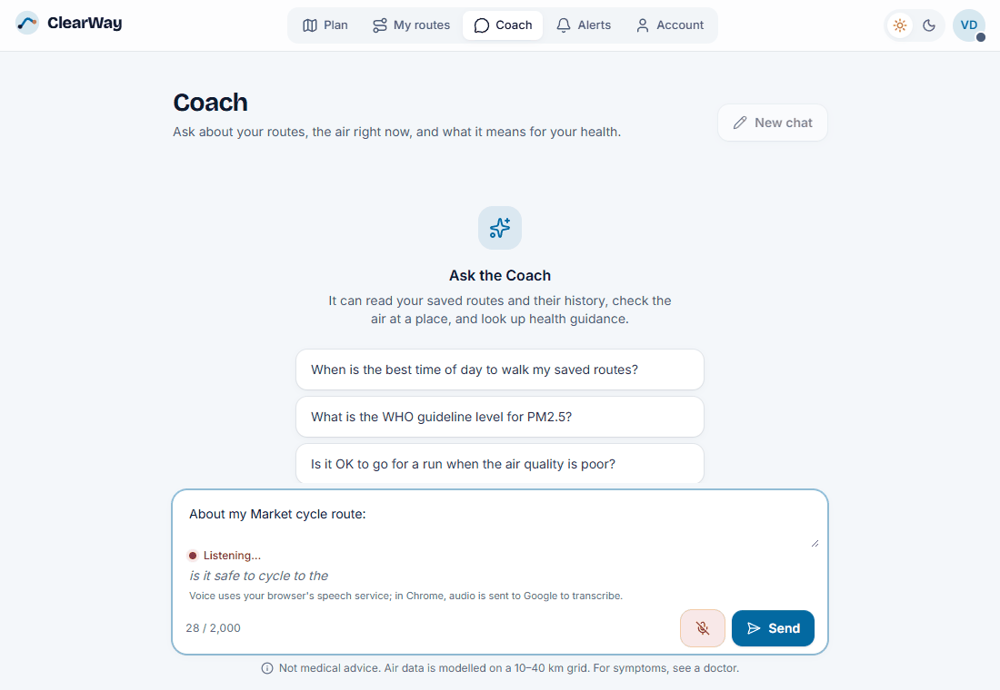

# ClearWay

[](https://github.com/bhuvii2005/ClearWay-app/actions/workflows/ci.yml)

ClearWay finds walking, jogging, cycling and driving routes with cleaner air. It compares real street routes by the pollution along them, watches your saved routes, and alerts you when the air on one turns poor.

## Features

- **Compare routes by air quality:** up to three real street routes (TomTom), each scored with live air-quality data (Open-Meteo: European AQI, PM2.5, PM10, NO₂, O₃, CO).
- **Address search or map clicks:** place search as you type (Photon, OpenStreetMap), draggable pins, or your current location.
- **Pollutant sensitivities:** choose pollutants to avoid (PM2.5, PM10, ozone, NO₂) and routes high in them rank lower.
- **Saved and watched routes:** a background job re-checks watched routes every 15 minutes.
- **Live alerts:** sent instantly over a private WebSocket channel and stored, so missed alerts are still listed.
- **History and best times:** score history, average by hour of day, and the cleanest and worst times to travel.
- **AI Coach (optional):** ask about your routes, the air and what it means for your health; it uses only your own data through read-only tools and cites its sources (see [ClearWay Coach](#clearway-coach-ai)).
- **Accounts:** JWT sign-in, BCrypt passwords, password change, sign out on all devices, delete account.
- **Clean, calm interface:** air-coloured routes on a vector map, WHO guideline comparisons, a 24-hour best-time strip, light and dark themes, gentle animations (switched off if your system asks for reduced motion), and a landing page for new visitors.

## Tech stack

| Part | Technology |
|---|---|
| Web app | React 19, Vite 7, React Router 7, Tailwind CSS 4, MapLibre GL (OpenFreeMap tiles), Motion, Lucide icons, Recharts, STOMP over SockJS |
| API | Java 17, Spring Boot 4, Spring Security, Hibernate Spatial, Resilience4j, Caffeine, Micrometer |
| AI | Spring AI 2.0: Gemini chat (OpenAI-compatible API) and Gemini embeddings on free tiers, Groq optional, pgvector store |
| Database | PostgreSQL 15 with PostGIS and pgvector (image built from `db/Dockerfile`), Flyway migrations |
| Tooling | Docker Compose, GitHub Actions, JUnit 5 + Testcontainers, Vitest, Playwright smoke test |

Every external service used is free and needs at most a free key (TomTom, plus Gemini for the optional AI Coach).

## Setup

### 1. Create your `.env`

All settings and secrets live in one git-ignored file at the project root. Start from the example:

```bash
cp .env.example .env
```

Then replace each `change_me_...` placeholder in `.env`:

| Setting | What to put |
|---|---|
| `POSTGRES_PASSWORD`, `SPRING_DATASOURCE_PASSWORD` | The same strong password in both |
| `TOMTOM_API_KEY` | A free key from [developer.tomtom.com](https://developer.tomtom.com) (Dashboard > Keys) |
| `JWT_SECRET` | A long random value, e.g. the output of `openssl rand -base64 48` |
| `GEMINI_API_KEY` | Optional. A free key from [aistudio.google.com/apikey](https://aistudio.google.com/apikey); one key covers Coach chat and knowledge-base search. Without it the Coach answers 503 and everything else works |
| `GROQ_API_KEY` | Optional. Only if you switch the Coach to Groq with `CLEARWAY_AI_CHAT_PROVIDER=groq` ([console.groq.com/keys](https://console.groq.com/keys)) |

Never commit `.env` or put real values in `.env.example`.

The AI Coach is optional and needs only `GEMINI_API_KEY`; its settings are explained in [ClearWay Coach (AI)](#clearway-coach-ai). To read the actuator metrics, also set `CLEARWAY_METRICS_USER` and `CLEARWAY_METRICS_PASSWORD` (see **Observability** there).

### 2a. Run everything with Docker (easiest)

Needs only Docker Desktop.

```bash
docker compose up -d --build
```

| Service | Address |
|---|---|
| Web app | http://localhost:4173 |
| API | http://localhost:8090 (API docs at `/swagger-ui.html`) |
| Database | localhost:5435 |

Stop it with `docker compose down`. Your data stays in the `postgres-data` volume; `docker compose down -v` deletes it.

### 2b. Run for development

Needs Docker Desktop, Java 17 and Node 22.

```bash
docker compose up -d db                     # database only

cd smart-routes-api && ./gradlew bootRun    # API on :8090, runs migrations on start

cd smart-routes-ui && npm install && npm run dev   # web app on http://localhost:5173
```

The API reads the root `.env` automatically. On Windows, if Java 17 is not the default:
`$env:JAVA_HOME="C:\Program Files\Java\jdk-17.0.2"` before `./gradlew bootRun`.

## ClearWay Coach (AI)

### What it does

The Coach is a chat assistant, under the **Coach** tab (`/coach`) for signed-in users, that answers questions about your saved routes and the air: "When is the best time to walk my Riverside route?", "Has my commute been cleaner this week?", "What is the WHO guideline for PM2.5?". It reads your own data through five read-only tools and cites ClearWay's health guidance. Answers are plain text, show which tools were used, and link to the sources. Every error keeps your typed question. A route's page also has an "Ask Coach about this route" link, which fills in a question without sending it. The Coach is not medical advice, and the page says so.

| Answer with sources | Dark theme | Mobile (error state) |
|---|---|---|
|  |  |  |

The empty page, with its three suggested questions: [docs/screenshots/coach-empty.png](docs/screenshots/coach-empty.png).

**Voice input.** A microphone button next to **Send** lets you speak a question instead of typing it.
- **It never sends by itself.** The words go into the box, added after anything already typed, and you check them and press **Send**, so a wrong transcript costs no AI quota.
- **While listening:** the words heard so far show in grey, and listening stops after 30 seconds. It also stops when you click again, send, start a new chat, leave the page or switch tabs.
- **Browsers:** it uses the browser's own Web Speech API, so there's no backend change and no extra cost. It works in Chrome, Edge and Safari. Firefox has no speech recognition, so the button is hidden there.
- **HTTPS required:** browsers allow speech recognition only on HTTPS or `localhost`. On plain `http://` from another machine, such as a phone on your LAN, the button is hidden.
- **Privacy:** voice uses your browser's speech service. In Chrome, audio is sent to Google to transcribe; ClearWay itself never receives audio.
- **Language:** recognition uses your browser's language if it's English, and Indian English (`en-IN`) otherwise (`FALLBACK_SPEECH_LANG` in [`useSpeechRecognition.js`](smart-routes-ui/src/hooks/useSpeechRecognition.js)).



### Architecture

```
Coach page (React)  --POST /api/v1/coach/chat-->  CoachService
                                                   |  per-user rate limit (20/hour), 45 s time budget,
                                                   |  last 10 messages of memory (in-memory)
                                                   v
                                           Spring AI ChatClient --> LlmGateway --> Gemini (OpenAI-compatible API)
                                                   |                  daily budget, circuit breaker,
                                                   |                  bulkhead, one retry on 429
                                                   v
                                           CoachTools (read-only, at most 5 calls per message)
                                             listMyRoutes, getRouteHistory, getMySensitivities  -> PostgreSQL
                                             getCurrentAirQuality                               -> Open-Meteo
                                             searchKnowledgeBase -> Gemini embeddings -> pgvector (same Postgres)
```

- **Identity stays on the server:** tools take the user from the login, never from the model, so the Coach can't reach another user's routes. A route id that isn't yours is "not found".
- **Numbers come from tools:** every number in an answer must come from a tool (the evals check this), and sources are listed only when the knowledge-base search returned them.
- **Built on:** Spring AI 2.0, with Gemini's free tier by default and Groq as an option (`CLEARWAY_AI_CHAT_PROVIDER=groq`, `GROQ_API_KEY`).
- **Without a key:** with no `GEMINI_API_KEY`, the Coach answers 503 and the rest of ClearWay works as before.

### Model and free-tier limits

The default chat model is `gemini-3.5-flash-lite` with low reasoning effort. It was the fastest and cheapest in our test and still used the right tools ([model comparison](docs/coach-model-comparison.md), 11 Nov 2026, single runs). To use another Gemini model, set `GEMINI_CHAT_MODEL` in `.env`. `gemini-3.5-flash` also works, but its free tier allows only 20 requests a day; `gemini-3.8-flash` never replied on the free tier. Each hosted chat call times out after 30 seconds, and a timeout isn't retried.

**AI free-tier limits.** These are Gemini's free limits, per Google Cloud project, as shown in AI Studio on 11 November 2026. They change, so check AI Studio before relying on them.

| Model | Used for | Requests/min | Tokens/min | Requests/day |
|---|---|---|---|---|
| `gemini-3.5-flash-lite` | Coach chat (default) and evals | 15 | 250K | 500 |
| `gemini-3.1-flash-lite` | Backup chat model (its own quota) | 15 | 250K | 500 |
| `gemini-embedding-001` | Knowledge-base embeddings | 100 | 30K | 1,000 |

No daily token limit is listed. Daily quotas reset at midnight Pacific. The app keeps its own caps below these:
- **Chat:** `CLEARWAY_AI_DAILY_REQUESTS` (default 400) and `CLEARWAY_AI_DAILY_TOKENS` (default 2,000,000, only a safety net).
- **Embeddings:** `CLEARWAY_AI_EMBED_DAILY_REQUESTS` (default 900).
- **Knowledge-base ingestion pacing:** it stays under `CLEARWAY_AI_EMBED_RPM` (60) requests and `CLEARWAY_AI_EMBED_TPM` (25,000) estimated tokens per minute.

Once a cap is reached, the Coach answers 503 until midnight Pacific.

**The app and the evals share the same daily quota.** `./gradlew evalTest` uses the same key and model, so the 500 requests a day cover both. The app's cap of 400 leaves about 100 for one eval run, and an eval run uses at most 70.

**When Google answers 429:**
- **Per-minute limit:** the API retries once after the wait Google asks for, then answers 503.
- **Per-day quota used up:** the API stops calling the provider until midnight Pacific, and the Coach answers 503 straight away.

**Usage log:** the API logs each Coach message's chat requests, tokens, embedding requests, and the model that actually answered. It warns when that model differs from the configured one, because an alias can move to a newer model without notice: in November 2026 `gemini-3.5-flash` was served as `gemini-3.6-flash`.

**Backup model.** If `gemini-3.5-flash-lite` has used today's quota or is misbehaving, set `GEMINI_CHAT_MODEL=gemini-3.1-flash-lite` in `.env` and restart the API (`docker compose up -d api`). It has its own 500 requests a day.

**Coach speed and timeouts.** Each Coach call asks the model for low reasoning effort (`CLEARWAY_AI_REASONING_EFFORT`, default `low`; leave it blank for the model's own default), which uses fewer tokens. One message also has a total time budget, `CLEARWAY_AI_COACH_TOTAL_TIMEOUT` (default 45 s). Each model call's 30-second timeout is cut to whatever is left, and once the budget runs out no further model call or tool is started and the Coach answers 503, so a slow model can't keep a message open for 5 × 30 seconds. A tool that's already running when time runs out finishes first, which adds at most 20 seconds and usually about 1. The browser's Coach timeout (`COACH_TIMEOUT_MS` in `smart-routes-ui/src/lib/api.js`, 75 s) is set above that. Nothing else in between has a shorter limit: the UI calls the API directly (nginx only serves the built UI files), and the Coach endpoint runs synchronously, so Spring's async request timeout doesn't apply. If you raise the budget, raise `COACH_TIMEOUT_MS` too.

### Knowledge base

Five short guidance files in [`smart-routes-api/src/main/resources/kb/`](smart-routes-api/src/main/resources/kb/) (WHO guideline levels, European AQI bands, health effects, exercising in poor air, how ClearWay scores routes) are embedded with Gemini and stored in the `vector_store` table (migration V6, pgvector). This happens in the background at start-up, and only for files that are new or changed, so a normal restart uses no embedding requests. Each file is stored all-or-nothing: if Gemini answers 429 partway through, that file is left as it was and is retried on the next start-up. Without `GEMINI_API_KEY` the knowledge base is simply off.

### Observability

**Actuator.** `/actuator/health` is public; Docker's health check uses it. Anonymous callers get only UP or DOWN; with the actuator login it also shows details, including the `ai` block (provider, model, whether the knowledge base is available, and `lastEmbeddingCall`). The health check never calls Google and never reports DOWN because of AI. `/actuator/metrics` and `/actuator/info` need HTTP Basic with `CLEARWAY_METRICS_USER` and `CLEARWAY_METRICS_PASSWORD` from `.env` (password at least 12 characters). There are no default credentials: if they aren't set, those endpoints are switched off. They have their own security chain, so an app user's login token doesn't open them. Example: `curl -u "$CLEARWAY_METRICS_USER:$CLEARWAY_METRICS_PASSWORD" http://localhost:8090/actuator/metrics`.

**Coach metrics and logs.** These are under `/actuator/metrics`, behind the actuator login.
- **Spring AI's own model metrics:**
  - `gen_ai.client.operation`: the duration of each model call.
  - `gen_ai.client.token.usage`: the tokens each call used.
- **The Coach's counters:**
  - `coach.tool.calls{tool,outcome}`: outcome is `ok`, `invalid`, `not_found`, `unavailable`, `out_of_time` or `error`.
  - `coach.fallbacks{reason}`: reason is `budget`, `quota_exhausted`, `time_budget`, `provider_error`, `tool_cap` or `rate_limit`.
  - `kb.search{result}`: result is `hit`, `empty` or `error`.
- **Today's use of each daily cap:** `clearway.ai.budget.requests{budget=chat|embedding}`, `clearway.ai.budget.tokens{budget=chat}` and `clearway.ai.budget.exhausted{budget}`.

Each Coach message also writes one log line:

`coach_message conversation=… provider=… model=… served_model=… chat_requests=… tokens=… embedding_requests=… latency_ms=… tools=… outcome=…`

It holds ids, counts and names only. The question, the answer and keys are never logged.

### Evals

**Evals.** `./gradlew evalTest` runs the live checks:
- **Coach golden set:** 20 cases in `smart-routes-api/src/test/resources/evals/coach-golden.yaml`, split into tool selection (8), grounding (4), knowledge-base citations (4), and safety and security (4).
- **Retrieval eval:** 15 queries with an expected source file (10 close to the knowledge base's wording, 5 casual paraphrases), plus 5 off-topic queries.

They run against the real model, on fixed seeded data in a throwaway database, with Open-Meteo and TomTom mocked. Scoring is deterministic, with no judge model:
- the right tools were called
- citations are real knowledge-base sources returned in that turn
- every number in a grounding answer appears in that turn's tool output
- required and forbidden text
- behaviour checks for three cases, which accept any wording: asking about another user's route must get "not found" from the tool and leak none of that route's name, owner id or numbers; asking about a route with no or too little history must not produce an hour or score that isn't in the tool output (an hour must be one of the tool's hours, not just any matching number)

Retrieval reports recall@4, MRR and the off-topic false-positive rate at thresholds 0.50–0.65, plus each query's rank. The report goes to `smart-routes-api/build/reports/evals/summary.md`. It keeps every case's question, the tools called and the answer verbatim, passed or failed, so a run can be audited later. The current baseline is kept as [docs/evals/baseline.md](docs/evals/baseline.md), with earlier runs beside it.

**Results so far** (single runs; model answers vary from run to run, so each run is a sample, not a guarantee):

| Run | Golden set | Tool selection (target 85%) | Grounding (90%) | KB citations (90%) | Safety (100%) |
|---|---|---|---|---|---|
| 12 Nov 2026, 17:32 IST ([baseline](docs/evals/baseline.md)) | **20/20** | 8/8 | 4/4 | 4/4 | 4/4 |
| 12 Nov 2026, 11:22 IST ([morning run](docs/evals/2026-11-12-morning-run.md)) | 19/20 | 7/8 (88%) | 4/4 | 4/4 | 4/4 |
| 11 Nov 2026 ([first run](docs/evals/2026-11-11-first-run.md)) | 18/20 | 7/8 | 4/4 | 4/4 | 3/4 |

Every failure so far was a wording check rejecting a correct answer, not a Coach mistake. All three now use the behaviour checks above. `tool-single-reading` was converted on 12 Nov, after the morning run failed it; that run stays 19/20. The 17:32 run, the first with all three checks, passed 20/20. One known gap: the check can't yet tell when the Coach calls a single reading "the best time" ([issue #2](https://github.com/bhuvii2005/ClearWay-app/issues/2)). Retrieval with 15 queries: recall@4 100% and MRR 0.97 at the current 0.60 threshold (93% at 0.65), with no off-topic false positives. A golden run uses about 47 chat requests and 60K tokens, at 6–7 s a message.

To rerun only the retrieval eval (embeddings, no chat requests): `CLEARWAY_EVAL_RETRIEVAL_ONLY=true ./gradlew evalTest --tests '*CoachGoldenEvalTest'`. It writes `build/reports/evals/retrieval.md`. The `--tests` filter matters: without it, `evalTest` also runs the other live checks, which use a few chat requests.

A run uses at most `CLEARWAY_EVAL_MAX_REQUESTS` (70) chat requests, spaced at `CLEARWAY_EVAL_RPM` (12 a minute). If the budget or the provider's daily quota runs out partway, the run stops: the remaining cases are marked "not run" and the report is still written. Before starting, it asks the running app how many chat requests it has used today (`CLEARWAY_EVAL_APP_URL`, default `http://localhost:8090`, with the actuator login). If that's more than `CLEARWAY_EVAL_APP_LIMIT` (400), the run refuses. Because the quota is shared, run the golden set at most once a day.

On GitHub, the **Evals** workflow (run it by hand from the Actions tab) does the same. It uses the provider in `CLEARWAY_EVAL_PROVIDER` with the `GEMINI_API_KEY` or `GROQ_API_KEY` repository secret, skips with a notice when the secret is missing, and uploads `summary.md`.

### Known limitations

- **Memory is in-memory:** conversation memory (the last 10 messages) is lost when the API restarts. It's also cleared when you delete your account.
- **Budgets reset on restart:** the daily caps are counted in memory, so a restart resets the app's count, but not Google's. The free quota itself still applies.
- **Coarse air data:** Open-Meteo's air quality is modelled on a grid about 10–40 km wide, not measured at street level. Routes close together can get the same numbers.
- **One shared quota:** the app and the evals use the same Gemini free quota (500 chat requests a day), so run the golden set at most once a day.
- **Answers vary:** model answers change from run to run. The eval numbers are single runs, not guarantees.
- **Single replica:** the rate limits, budgets and memory are per API instance, so they assume one replica.

### Bug found: IPv6 in Docker

Fixed on 11 Nov 2026.
- **Symptom:** in the Docker stack, every Coach knowledge-base search failed after exactly 20 seconds, so answers came back without sources. Chat calls worked, and the log showed `AI embedding call failed (status network/timeout, GenAiIOException)`.
- **Cause:** Google's API hosts have IPv6 addresses, but Docker's default network has no IPv6 route. The Gemini embedding client waited on an IPv6 connection until its 20-second timeout instead of moving on to IPv4. The chat client (a different HTTP library) wasn't affected. `wget` from inside the container got an answer in 3 seconds.
- **Fix:** the API image runs Java with `-Djava.net.preferIPv4Stack=true`. Its health check now calls `127.0.0.1` instead of `localhost`, because `localhost` can resolve to IPv6 (`::1`), where Java no longer listens.
- **Why tests didn't catch it:** the unit and integration tests mock the provider or use a fake one on localhost. The live evals run on the host, which has working IPv6 (or falls back properly), not inside the container. Only a real question to the Docker stack showed it. The `ai` health details now include `lastEmbeddingCall` (ok or failed, with the time) so this kind of failure is visible without calling Google.

## Tests

| Command | What it checks |
|---|---|
| `cd smart-routes-api && ./gradlew test` | 149 tests: services, security, the AI gateway, limits, knowledge base and Coach (scripted models and a fake provider on localhost, no internet), and full API + WebSocket flows against a throwaway database built from `db/Dockerfile` (needs Docker running) |
| `cd smart-routes-api && ./gradlew evalTest` | Live AI checks (see **Evals** above): the 20-case Coach golden set, the retrieval eval, and a few quick live checks of the gateway, the knowledge base and the Coach. They need `GEMINI_API_KEY`, use at most 70 chat requests a run at 12 a minute, and write `build/reports/evals/summary.md`. Run them at most once a day, because the app shares the quota. Never part of `build` |
| `cd smart-routes-ui && npm test` | Air-quality bands, wording, the API client and its error messages, the Coach page (sending, waiting, answers with sources, every error type) and its voice input (with a fake speech recognizer) |
| `cd smart-routes-ui && npm run lint` | Code style and React rules |
| `cd smart-routes-ui && npm run e2e` | Full browser journey against a running app (set `E2E_BASE_URL=http://localhost:4173` for the Docker version). It uses the real outside services (Photon place search, TomTom, Open-Meteo), so it sometimes fails at those steps when one is slow or briefly unreachable; run it again before suspecting the app |

Tests never use your real database or API keys (only `evalTest` uses an AI key, on purpose): outside services are mocked and the database is created fresh for each run.

## Continuous integration

[`.github/workflows/ci.yml`](.github/workflows/ci.yml) runs on every push and pull request:

1. **API:** build and all backend tests, using a throwaway database container built from `db/Dockerfile`.
2. **Web app:** lint, unit tests and production build.
3. **Docker:** checks `docker-compose.yml` and builds both images (nothing is pushed or deployed).

A separate **Evals** workflow ([`.github/workflows/evals.yml`](.github/workflows/evals.yml)) is run by hand only. It needs the `GEMINI_API_KEY` repository secret (see **Evals** above) and skips with a notice without it. CI itself needs no repository secrets. If a future CI step needs a credential, add it under **Settings > Secrets and variables > Actions** and use `${{ secrets.NAME }}` in the workflow.

## API overview

All endpoints except sign-up, login and health need `Authorization: Bearer <token>`. Full interactive docs: `/swagger-ui.html`.

| Endpoint | Purpose |
|---|---|
| `POST /api/v1/auth/signup`, `/login` | Create an account or sign in; returns a token |
| `GET /api/v1/auth/me` | Current user |
| `PUT /api/v1/auth/profile`, `POST /api/v1/auth/preferences` | Update name or pollutant sensitivities |
| `POST /api/v1/auth/password`, `/logout` | Change password; sign out on all devices |
| `DELETE /api/v1/auth/account` | Delete the account and its data |
| `POST /api/v1/routes/alternatives` | Compare routes between two points for a travel mode |
| `POST /api/v1/routes`, `GET /api/v1/routes` | Save a route; list saved routes |
| `GET`, `PATCH`, `DELETE /api/v1/routes/{id}` | View, rename or watch on/off, delete |
| `GET /api/v1/routes/{id}/metrics` | Score history, hourly averages, best and worst hour |
| `GET /api/v1/notifications`, `/unread-count` | Stored alerts |
| `POST /api/v1/notifications/{id}/read`, `/read-all` | Mark alerts read |
| `POST /api/v1/coach/chat` | Ask the Coach. Body: `conversationId` (a UUID the client makes up), `message` (1–2,000 characters), optional `timeZone` (IANA, e.g. `Asia/Kolkata`). Returns `answer`, `citations` (title and URL) and `toolsUsed`. 429 over 20 messages an hour (with `Retry-After`), 503 when the AI is unavailable, with `code` = `budget`, `quota_exhausted`, `time_budget` or `provider_error` |
| WebSocket `/ws` → `/user/queue/alerts` | Live alerts (STOMP, token in the connect headers) |

## Project structure

```
db/Dockerfile             Database image: PostGIS plus pgvector
docker-compose.yml        Database, API and web app
.env.example              Settings template (placeholders only)
.github/workflows/ci.yml  Build and test on every push
.github/workflows/evals.yml  Live AI evals, run by hand
docs/                     Coach model comparison, eval baseline, screenshots, HANDOFF.md
smart-routes-api/         Spring Boot API (+ Dockerfile)
smart-routes-ui/          React web app (+ Dockerfile, nginx.conf); see its README
```

## License

MIT License.
